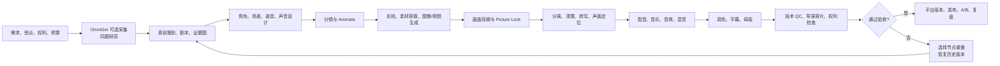

# ZimaBlueAI Produce Cinematic Video 中文安装与使用说明

本 skill 由 ZimaBlueAI 设计并维护。文中第三方产品、模型和项目名称仅用于说明可选互操作能力，不表示其赞助、背书、合作或参与本 skill 的创作。

本 skill 面向动画、短片、纪录片、电影、宣传片、课程视频和社交短视频，覆盖同题研究、策划、剧本、角色与视觉设计、模型生成、专业剪辑、声音制作、质检、营销评估和发布复盘。它把每一步保存为可追溯工程资产，支持暂停、节点重做和历史版本恢复。

本文只列普通用户真正需要填写的配置。没有启用的 provider、模型或高级调优项不要写入 `.env.local`。

## 目录

- [工作流总览](#工作流总览)
- [安装位置](#安装位置)
- [基础依赖](#基础依赖)
- [初始化与 TUI 配置](#初始化与-tui-配置)
- [按任务选择模型](#按任务选择模型)
- [最小配置变量](#最小配置变量)
- [首次测试](#首次测试)
- [OmniGet 同题研究](#omniget-同题研究)
- [工程看板、节点重做与历史版本](#工程看板节点重做与历史版本)
- [音频、配音与混音](#音频配音与混音)
- [生成音乐和音效提示词](#生成音乐和音效提示词)
- [安全、权利与预算](#安全权利与预算)
- [成片验收](#成片验收)
- [深入阅读](#深入阅读)

## 工作流总览



核心原则：

1. 原始素材只读，所有处理写入新文件。
2. 先完成策划、分镜和低成本验证，再调用付费模型。
3. 用户要求 Seedance 类模型时，必须交付真实模型生成镜头；HTML2Video、平移缩放、Pillow/OpenCV 动画只能标为 animatic、合成或预览。
4. 自动结果先进入 `review`，经过人工审片后才能成为 `approved`。
5. 工程中的素材、提示词、模型、成本、授权、拒绝原因和验收证据都可追溯。

## 安装位置

解压后应直接看到 `produce-cinematic-video/SKILL.md`，不要多套一层同名目录。

| 主机 | 用户级安装目录 |
|---|---|
| Codex | `~/.codex/skills/produce-cinematic-video` |
| Claude Code | `~/.claude/skills/produce-cinematic-video` |

Windows、macOS 和 Linux 都使用用户目录；只有需要项目隔离或固定版本时，才安装到项目的 `.codex/skills/` 或 `.claude/skills/`。

个人配置与 skill 分离，升级 skill 不会覆盖它：

| 系统 | 配置文件 |
|---|---|
| Windows | `%APPDATA%\produce-cinematic-video\.env.local` |
| macOS | `~/Library/Application Support/produce-cinematic-video/.env.local` |
| Linux | `${XDG_CONFIG_HOME:-~/.config}/produce-cinematic-video/.env.local` |

大型模型、独立 Python 环境和缓存放在本机用户数据目录，不放进 skill、Git 仓库或漫游配置目录。查看本机解析出的全部位置：

```text
python <skill-dir>/scripts/configure.py paths
```

macOS/Linux 如果命令名是 `python3`，把本文命令中的 `python` 替换为 `python3`。

## 基础依赖

### 必装

- Python 3.10 或更高版本；
- 完整版 FFmpeg；
- 与 FFmpeg 同一发行包中的 FFprobe。

FFmpeg 必须包含常用转码、抽帧、拼接、响度与检测滤镜。不要使用浏览器、Playwright 或其他软件附带的精简版。

### 按任务安装

| 依赖 | 何时需要 |
|---|---|
| ImageMagick | 静帧合成、格式转换、标注和批处理 |
| Pillow | Python 图像处理或蒙版工作流 |
| OpenCV | 视觉分析、嘴部运动和声画同步候选 |
| PySceneDetect | 镜头粗切；生产环境建议另配 TransNetV2 精修 |
| jsonschema | 完整校验工程 manifest 和 edit plan |
| SoX | Qwen3-TTS、IndexTTS2 等本地语音链路需要时 |
| NumPy | 视觉、音频和分析脚本 |

普通视频脚本环境可安装 skill 提供的可选清单：

```text
python -m pip install -r <skill-dir>/requirements-optional.txt
```

不要把 Qwen3-TTS、IndexTTS2、Pocket TTS、LuxTTS 或 GPT-SoVITS 的锁定依赖混装进这个环境；每个模型使用自己的官方 Python 环境。

常见系统安装入口：

- Windows：从 [FFmpeg 官方下载页](https://ffmpeg.org/download.html)安装完整 build，从 [ImageMagick 官方下载页](https://imagemagick.org/download/)安装 ImageMagick；需要 SoX 时可运行 `winget install --id ChrisBagwell.SoX --exact`。
- macOS：已使用 Homebrew 时运行 `brew install ffmpeg imagemagick sox`。
- Debian/Ubuntu：运行 `sudo apt install ffmpeg imagemagick sox libsox-fmt-all`。

安装后运行只读诊断：

```text
python <skill-dir>/scripts/environment_doctor.py
```

## 初始化与 TUI 配置

首次使用先创建用户级 `.env.local`：

```text
python <skill-dir>/scripts/configure.py init
```

推荐使用跨平台终端配置界面：

```text
python <skill-dir>/scripts/configure.py tui
```

TUI 不依赖 curses 或 Textual，可在 Windows PowerShell、macOS Terminal 和 Linux 终端运行。它只询问当前选择所需的值，密钥使用隐藏输入，不进入聊天或命令行历史。

初始配置只有：

```dotenv
PCV_FFMPEG=ffmpeg
PCV_FFPROBE=ffprobe
```

常用管理命令：

```text
python <skill-dir>/scripts/configure.py path
python <skill-dir>/scripts/configure.py show
python <skill-dir>/scripts/configure.py validate
python <skill-dir>/scripts/configure.py compact
```

`show` 会隐藏密钥；`compact` 只预览精简结果，只有用户明确运行 `compact --confirm` 才会先归档旧配置并写入精简版。

旧版 `config.json` 迁移为 `.env.local`：

```text
python <skill-dir>/scripts/configure.py migrate
```

如果旧 JSON、聊天或日志中出现过真实密钥，先在提供方吊销并生成新密钥，再迁移。

## 按任务选择模型

| 任务 | 推荐路径 |
|---|---|
| 角色、场景、参考帧生成/编辑 | Gemini Nano Banana 中转或 GPT Image 2 |
| 让已批准的动画角色真正动起来 | Seedance 图生视频；私密素材可选本地 LTX-Video |
| 中文甜美女声、姐姐/妈妈音色、自由情绪设计 | Qwen3-TTS VoiceDesign |
| 中文、已授权的声音克隆和情感参考 | IndexTTS2 或 Qwen3-TTS Base |
| 无 GPU，英语及其官方支持的欧洲语言 | Pocket TTS |
| 低显存/CPU、48 kHz 克隆候选 | LuxTTS，先做语言专项试听 |
| 人声/伴奏、去混响、去回声 | 本地 GPT-SoVITS UVR5 |
| 音乐、转场音、环境、Foley、SFX | 生成 Suno/Udio/ElevenLabs 提示词包，再人工或授权 API 生成 |

GPU 策略：

- Qwen3-TTS、IndexTTS2 和 GPT-SoVITS 优先使用其专用环境实际可见的 CUDA；
- LuxTTS 自动按 CUDA → Apple MPS → CPU 选择；
- Pocket TTS 固定为 CPU 优先；
- 不以“电脑有显卡”代替 runtime doctor 的实际结果。

Pocket TTS 当前不支持中文。LuxTTS 上游未公布可靠语言矩阵，正式使用前必须做 10–20 秒试听、人工听辨和 ASR 回验。

## 最小配置变量

只配置本次任务实际使用的行；不要把整张表复制进 `.env.local`。

| 能力 | 用户需要填写的最小变量 |
|---|---|
| GPT Image 2 | `PCV_OPENAI_IMAGE_ENABLED`、`PCV_OPENAI_IMAGE_MODEL`、`PCV_OPENAI_IMAGE_API_KEY` |
| Gemini Nano Banana 中转 | `PCV_GEMINI_IMAGE_ENABLED`、`PCV_GEMINI_IMAGE_ENDPOINT`、`PCV_GEMINI_IMAGE_MODEL`、`PCV_GEMINI_IMAGE_API_KEY` |
| Seedance | `PCV_SEEDANCE_ENABLED`、`PCV_SEEDANCE_MODEL`、`PCV_SEEDANCE_API_KEY` |
| Qwen3-TTS 声音设计 | `PCV_QWEN3_TTS_ENABLED`、`PCV_QWEN3_TTS_PYTHON`、`PCV_QWEN3_TTS_VOICE_DESIGN_MODEL` |
| IndexTTS2 | `PCV_INDEX_TTS2_ENABLED`、`PCV_INDEX_TTS2_PYTHON`、`PCV_INDEX_TTS2_REPO_DIR`、`PCV_INDEX_TTS2_MODEL_DIR` |
| Pocket TTS | `PCV_POCKET_TTS_ENABLED`、`PCV_POCKET_TTS_PYTHON`、`PCV_POCKET_TTS_LANGUAGE` |
| LuxTTS | `PCV_LUX_TTS_ENABLED`、`PCV_LUX_TTS_PYTHON`、`PCV_LUX_TTS_REPO_DIR`、`PCV_LUX_TTS_MODEL` |
| GPT-SoVITS UVR5 | `PCV_GPT_SOVITS_ENABLED`、`PCV_GPT_SOVITS_REPO_DIR` |

模型 ID/模型目录必须填写：它决定真实调用、能力判断和复现，不能只填 API key。

远程图像和视频 provider 推荐用隐藏输入向导逐个配置：

```text
python <skill-dir>/scripts/configure.py setup-provider gemini-image
python <skill-dir>/scripts/configure.py setup-provider openai-image
python <skill-dir>/scripts/configure.py setup-provider seedance
```

一次只运行需要的一条。Gemini 中转必须填写完整的 `PCV_GEMINI_IMAGE_ENDPOINT`，例如以 `/v1beta/models/<model>:generateContent` 结尾；适配器原样调用该中转，不静默回退默认官方地址。endpoint 中不要包含 `?key=`，密钥单独写入 `PCV_GEMINI_IMAGE_API_KEY`。

GPT-SoVITS 推荐通过目录向导配置：

```text
python <skill-dir>/scripts/configure.py setup-local gpt-sovits --repo-dir <GPT-SoVITS目录>
```

`PCV_AUDIO_*` 不是 Qwen3-TTS、IndexTTS2、Pocket TTS、LuxTTS 或 GPT-SoVITS 的前置配置。只有用户另接一个通用远程音频 API/tool 时才使用它；否则不要填写。

## 首次测试

按以下顺序测试，不需要一开始就付费生成：

1. 验证配置和核心工具：

   ```text
   python <skill-dir>/scripts/configure.py validate
   python <skill-dir>/scripts/environment_doctor.py
   ```

2. 检查实际启用的本地 runtime：

   ```text
   python <skill-dir>/scripts/qwen3_tts.py doctor --runtime-import
   python <skill-dir>/scripts/index_tts2.py doctor --runtime-import
   python <skill-dir>/scripts/lightweight_tts.py --engine pocket doctor --runtime-import
   python <skill-dir>/scripts/lightweight_tts.py --engine lux doctor --runtime-import
   python <skill-dir>/scripts/gpt_sovits_uvr5.py doctor --runtime-import
   ```

   只运行已配置的项目。

3. 检查 Seedance 鉴权但不创建任务：

   ```text
   python <skill-dir>/scripts/seedance_video.py --provider seedance_video --auth-check
   ```

4. 用 dry-run 检查请求路由、输入哈希和参数：

   ```text
   python <skill-dir>/scripts/generate_image.py --provider gemini_image edit --prompt-file edit.prompt.txt --input approved-reference.png --output edited.png --aspect-ratio 9:16 --image-size 1K --dry-run
   python <skill-dir>/scripts/seedance_video.py --provider seedance_video --prompt-file shot.prompt.txt --first-frame approved-animation.png --content-class animation --rights-basis "user supplied; approved scope" --duration 5 --output shot.mp4 --dry-run
   ```

5. 真实远程调用前，核对当前价格、输入素材、上传范围和预算；只有本次都批准时才添加：

   ```text
   --approve-remote-upload --approve-cost
   ```

输出文件已存在时脚本会拒绝覆盖。每次成功调用都会写不含密钥的 provenance。

## OmniGet 同题研究

[OmniGet](https://github.com/tonhowtf/omniget) 是可选桌面采集和整理工具。用户可用它处理自己有权访问的页面、字幕、Whisper、片段和时间戳笔记，再把明确导出的目录交给 PCV 做只读理解。

不需要任何 `PCV_OMNIGET_*` 配置，也不读取浏览器 cookie、登录态、剪贴板、OmniGet 数据库、付费课程或 DRM 内容。

先预览入库：

```text
python <skill-dir>/scripts/research_ingest.py --input-dir <authorized-export> --output research/source-manifest.json --collection-title "<主题>" --rights-basis research-only --dry-run
```

确认后去掉 `--dry-run`。脚本不下载、不移动、不改写源文件；它生成 checksum、FFprobe 技术信息并配对字幕和 `.info.json`，同时拒绝保存带 token/signature 的来源 URL。

随后按需执行媒体盘点、镜头检测、contact sheet、转写和关键时刻定位，最终形成：

- `research/reference-cards.json`；
- `planning/creative-brief.md`；
- `planning/originality-map.md`；
- `planning/beat-sheet.csv`；
- `planning/script.md`；
- `planning/experiment-plan.json`；
- `planning/approval.json`。

学习的是钩子、信息释放、情绪曲线、镜头节奏、声音结构和包装机制，不复制角色、镜头、台词、音乐或其他受保护表达。

## 工程看板、节点重做与历史版本

从模板创建项目 `project.json` 后，初始化 16 阶段工作流：

```text
python <skill-dir>/scripts/workflow_control.py init project.json
python <skill-dir>/scripts/workflow_control.py init project.json --confirm
```

第一条只预演，第二条才写入。生成离线交互看板：

```text
python <skill-dir>/scripts/pipeline_dashboard.py project.json --output dashboard.html
```

看板显示流程、当前节点、依赖、闸门、输入、生成物、采用/拒绝状态、音频 stems、同步、QC、成本和历史版本。它不会在浏览器中静默修改工程。

常用命令：

```text
python <skill-dir>/scripts/workflow_control.py status project.json
python <skill-dir>/scripts/workflow_control.py transition project.json --stage sound_mix --status review --note "v3 混音待审"
python <skill-dir>/scripts/workflow_control.py redo project.json --stage storyboard --reason "角色运动方向错误"
python <skill-dir>/scripts/workflow_control.py versions project.json
python <skill-dir>/scripts/workflow_control.py restore project.json --version <id> --reason "回到导演签收版"
```

`transition`、`redo` 和 `restore` 默认只预演；核对后追加 `--confirm`。每次实际修改前都会保存不可覆盖的历史快照；节点重做会把下游结果标成 `stale`，不会删除旧媒体。

## 音频、配音与混音

### 配音

- Qwen3-TTS VoiceDesign：适合先描述“甜美姐姐/温柔妈妈”等新音色，再用年龄感、气息、语速、笑意、亲密度和情绪弧导演表演。
- IndexTTS2：适合有明确同意记录的声音克隆，并可使用情感参考、向量或文本控制。
- Pocket/LuxTTS：只作为低资源补充；不把 Pocket 用于中文，不把未经试听批准的 LuxTTS 放进正式时间线。

所有声音克隆只接受本地 reference file，并要求非空 consent record。不要克隆未成年人、公众人物或未明确授权者来表达其未说内容。

### 分离与清理

GPT-SoVITS UVR5 可做 vocals/accompaniment、去混响或去回声，但分离 stem 是估计结果，不是原始多轨。先对 10–30 秒代表段做 A/B，再处理全片：

```text
python <skill-dir>/scripts/gpt_sovits_uvr5.py separate input.wav --model HP2_all_vocals --output-dir work/stems
```

没有相应权重时，不把“非人声”误标为“纯音乐”或“全部音效”。原音和每次中间处理都保留。

### 声画同步和混音

可见说话人依次经过人物/镜头确认、嘴部活动、VAD/ASR 字词时间码、限制搜索窗对齐和人工实时审片。`av_sync_align.py` 只提供候选偏移，不能仅凭嘴部运动识别精确音素。

混音用 dB 自动化，不用固定百分比。对白优先可懂度，音乐在对白频段和动态上让位，环境维持空间连续，音效突出关键动作。`mix_stems.py` 支持 dialogue、music、effects、ambience 的 gain、对白 side-chain ducking 和响度目标；参数先 dry-run，再依据当前 delivery profile 调整。

## 生成音乐和音效提示词

Suno、Udio 和 ElevenLabs 的提示词必须服务于具体画面、故事 beat、转场和情绪，不只写“电影感、好听、震撼”。

音乐提示词按以下顺序写：

```text
用途/时间段 + 叙事职责 + 起始情绪 → 转折 → 收束 +
速度与节拍 + 乐器/音色 + 动态与密度 +
需要配合的剪辑点/转场 + 是否可循环/是否要 stems +
禁止项（不要人声、不要抢对白、不要突兀结尾等）
```

音效提示词按以下顺序写：

```text
时间点 + 声源与动作 + 材质 + 空间/距离 + 力度与时长 +
转场职责 + 尾音/混响 + 禁止项
```

示例：

```text
为 00:08–00:13 的惊喜揭晓生成 5 秒转场音乐。前 2 秒保持轻柔期待，
第 3 秒随礼物盒打开出现温暖明亮的上扬，第 5 秒干净落点供切入祝福台词。
木琴、轻弦乐、柔和手拍，96 BPM；对白频段留空，不要歌词、重低音或长混响尾巴。
```

先生成 2–3 个低成本候选，按画面时间线试听；采用后记录 provider、模型、提示词、版本、授权和 cue sheet。完整模板见 `generated-music-and-sfx.md` 与 `assets/audio-generation-brief.template.md`。

## 安全、权利与预算

必须遵守以下硬闸门：

1. 不改写原始媒体，不覆盖输出。
2. 不把私有素材、真人或未成年人影像上传到远程 provider，除非用户明确批准上传范围且提供方当前政策允许。
3. Seedance 当前对真人参考有专门授权资产流程；未成年人照片默认只在本地合成，动画角色图与真人照片分开处理。
4. 声音克隆必须有可追溯同意记录；reference voice 只用本地文件。
5. 付费调用不得超过用户批准的次数和预算；网络中断但 task 状态未知时先查原 task，不能直接重复付费提交。
6. API key 只进入用户 `.env.local` 或秘密管理器，不进入聊天、命令行参数、项目文件、日志、provenance 或压缩包。
7. 不把生成、模拟或 reenactment 当作纪录片证据；合成内容按需要披露。
8. 不移除或重建水印来规避权利。应取得无水印且权利清楚的源文件；源图本来干净时，提示模型不要新增水印。
9. 知名动画角色或品牌素材可能被 provider 拒绝。保留失败记录，不通过改名或连续重试规避审核；改用经用户批准、轮廓和身份明显不同的原创角色设计。
10. 不对外发布、发送或投放，除非用户再次明确授权。

## 成片验收

至少运行：

```text
python <skill-dir>/scripts/validate_project.py --manifest <project-manifest>
python <skill-dir>/scripts/qc_media.py <master-video>
python <skill-dir>/scripts/contact_sheet.py <master-video> --output <contact-sheet>
```

再分别完成：

- 故事、表演、事实与连续性审片；
- 角色数量、脸、手脚、轮廓、文字、闪变和物理接触检查；
- 对白、音乐、音效、环境、响度、true peak 和声画同步试听；
- 字幕、可访问性、画幅、安全区、编码和平台版本检查；
- 来源、肖像、声音、音乐、品牌、AI 披露和预算核对；
- 标题、封面、首帧、CTA 和 A/B 假设检查。

点赞率、获客率或转化率只有在拥有足够、同口径的一方历史数据时才给区间估计；数据不足时返回 `not_estimable`，不编造“爆款概率”。

## 深入阅读

- 完整配置字段与排错：[`configuration.md`](configuration.md)
- 可恢复工作流与看板：[`workflow-orchestration.md`](workflow-orchestration.md)
- OmniGet 与同题研究：[`creative-research-and-planning.md`](creative-research-and-planning.md)
- Gemini / GPT Image：[`generative-image-providers.md`](generative-image-providers.md)
- Seedance：[`seedance-video.md`](seedance-video.md)
- Qwen3-TTS：[`qwen3-tts.md`](qwen3-tts.md)
- IndexTTS2：[`index-tts2.md`](index-tts2.md)
- Pocket TTS / LuxTTS：[`lightweight-tts.md`](lightweight-tts.md)
- GPT-SoVITS、分离与同步：[`audio-separation-and-sync.md`](audio-separation-and-sync.md)
- 音频后期：[`audio-post.md`](audio-post.md)
- 生成音乐与音效：[`generated-music-and-sfx.md`](generated-music-and-sfx.md)
- 质检和交付：[`qc-and-delivery.md`](qc-and-delivery.md)
- 营销评估与预测边界：[`evaluation-and-forecasting.md`](evaluation-and-forecasting.md)
